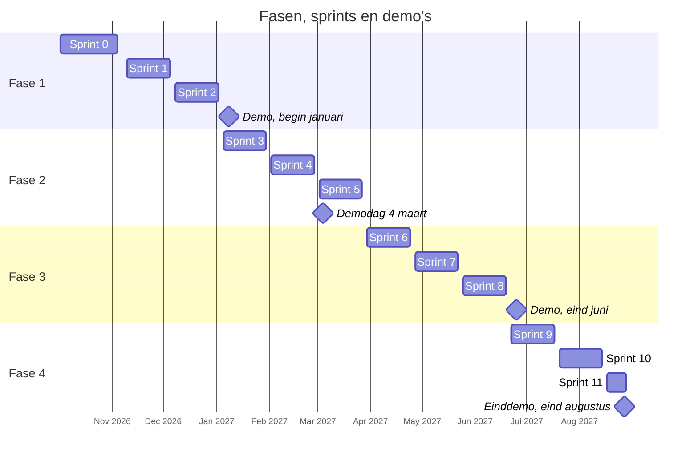

# Aanpak en planning

## Werkwijze

Het project loopt van oktober 2026 tot uiterlijk 1 september 2027. Het werkt agile: sprints van vier weken, gegroepeerd in vier fasen die samenvallen met de kwartalen Q4 2026 tot en met Q3 2027. Elke fase eindigt met een demo, een kwartaalrapportage aan de opdrachtgever, een feedbacksessie met gebruikers en een retrospective. De sporen AI Ready Standaarden en CompliancePush volgen dezelfde sprints met eigen opleveringen.

Het AI Readiness Assessment-kader meet hoe geschikt een publicatie is voor AI-agents en welke verbetering helpt, met een score die een onafhankelijke beoordelaar kan reproduceren; de nulmeting met dat kader is het startpunt. Fase 1 begint niet met het volledige kader, maar met een slanke versie van drie criteria en met één standaard, BGT|IMGeo, die meteen het hele proces doorloopt, inclusief skills en MCP. Elke volgende cyclus voegt een standaard toe en scherpt het kader aan. De pilotstandaarden zijn BGT|IMGeo met de metastandaarden NL-SBB en MIM, daarna DCAT-AP-NL, JSON Schema, een datacontractstandaard en OAS; public-code.yaml als er tijd over is.

Na de eerste technische realisatie volgt een expliciet go/no-go-moment. Daarin wordt getoetst of AI-ready standaarden aantoonbaar werken met meerdere AI-assistenten, wat het juiste ambitieniveau is voor automatisch bijwerken van software, wat juridisch verantwoord is met het oog op de AI Act, en onder welke voorwaarden en garanties AI-ready standaarden kunnen worden aangeboden.

## Fasen en succescriteria

### AI Ready Standaarden

| Fase | Kwartaal | Oplevering                                                                                                                                 | Succescriterium                                                                                     |
| ---- | -------- | ------------------------------------------------------------------------------------------------------------------------------------------ | --------------------------------------------------------------------------------------------------- |
| 1    | Q4 2026  | Assessment-kader met drie criteria; nulmeting op minimaal drie standaarden; prototype van artefacten, skill en validator voor BGT\|IMGeo   | Score reproduceerbaar door een onafhankelijke beoordelaar                                           |
| 2    | Q1 2027  | Tweede iteratie kader; manifestformaat; modellen en skills voor de overige pilotstandaarden; eerste meting van de prestaties van AI-agents | Meerdere AI-assistenten passen de modellen correct toe zonder extra instructies                     |
| 3    | Q2 2027  | MCP-services voor minimaal twee standaarden; publicatiepipeline-extensies                                                                  | Een agent voert via MCP een validatie uit met correct resultaat                                     |
| 4    | Q3 2027  | Conformiteitsdemonstratie; open source oplevering; eindrapport                                                                             | Agents presteren aantoonbaar beter met AI-ready standaarden dan met de oorspronkelijke documentatie |

### CompliancePush

| Fase | Kwartaal | Oplevering                                                                                      | Succescriterium                                        |
| ---- | -------- | ----------------------------------------------------------------------------------------------- | ------------------------------------------------------ |
| 1    | Q4 2026  | Analyse van bestaande tooling; requirements; formaat voor een Software Bill of Standards (SBOS) | Vastgesteld SBOS-formaat                               |
| 2    | Q1 2027  | Geautomatiseerde compliance-analyse van repositories, met en zonder SBOS                        | Meer dan 80 procent juistheid                          |
| 3    | Q2 2027  | Eerste automatische wijzigingsvoorstellen                                                       | Eigenaren van repositories accepteren de voorstellen   |
| 4    | Q3 2027  | Documentatie, open source oplevering, eindrapportage                                            | Beheerders van standaarden willen de tooling gebruiken |

## Sprintplanning

Elke fase heeft drie sprints van vier weken ([[[#tijdlijn]]]). Sprint 0 is de inceptiesprint: inrichting van repositories, Slack en de gebruikerswerkgroep, de start van het assessment-kader en het klaarzetten van de BGT-artefacten. De demo van fase 2 valt op de demodag van het Innovatiebudget op 4 maart 2027; de einddemo is eind augustus 2027.

<figure id="tijdlijn">

<figcaption>Fasen, sprints en demo's</figcaption>
</figure>

## Samenwerking

- **Ritme.** Wekelijkse stand-up; elke vier weken een bijpraatmeeting, een sprintreview en een optionele kantoordag bij Geonovum.
- **Tooling.** GitHub-repositories onder Geonovum-labs voor issues en projectborden; Slack.
- **Gebruikers vanaf de start.** Kadaster geeft input, valideert de resultaten in eigen omgeving en geeft feedback. Overheidsontwikkelaars, via developer.overheid.nl en de OSPO's, testen als vroege gebruikers in hun eigen werkomgeving. Standaardbeheerders beantwoorden interpretatievragen, reviewen inhoudelijk en keuren de AI-artefacten formeel goed. Samen vormen zij de gebruikerswerkgroep, die in sprint 0 wordt ingericht.
- **Bredere kring.** Een werkgroep softwareontwikkelaars en een werkgroep standaardengebruikers (gemeenten, provincies, waterschappen, uitvoeringsorganisaties) komen elk kwartaal bij de fasedemo samen. Het manifestformaat gaat in openbare consultatie.
- **Borging.** Alle resultaten open source onder EUPL of een vergelijkbare licentie, ontwikkeld in het openbaar op GitHub onder Geonovum-labs; Forum Standaardisatie betrokken bij de borging van de eindproducten; vroeg een beheerder zoeken voor de producten, zonder voortijdig in de beheerfase te gaan.
